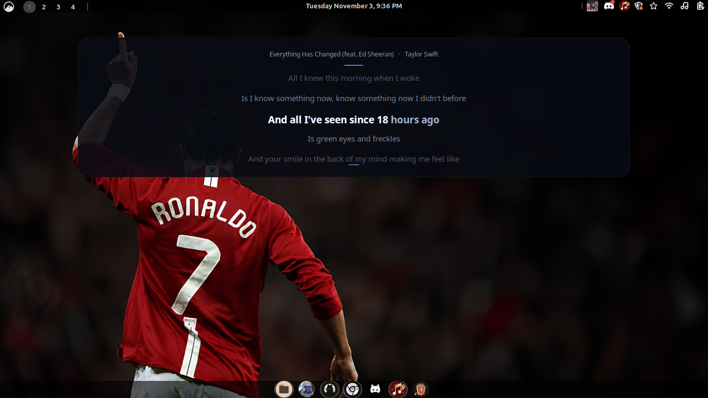

# Theòs Lyrics

A lightweight, cinematic lyrics overlay for Linux and Windows. Theòs Lyrics follows your music player, fetches synchronized lyrics, and displays them in an elegant floating window with a smooth karaoke-style highlight.

<p align="center">
  <strong>Python · GTK3 · Tkinter · MPRIS · Windows GSMTC · LRCLIB</strong>
</p>

## 📸 Screenshots

<p align="center">
  
</p>

<p align="center">
  <em>Theòs Lyrics — cinematic floating lyrics overlay.</em>
</p>

<p align="center">
  
</p>

<p align="center">
  <em>Another moment in the karaoke experience.</em>
</p>

## ✨ Features

- **Synchronized lyrics** — retrieves timestamped lyrics from [LRCLIB](https://lrclib.net/).
- **Karaoke-style highlighting** — a smooth, left-to-right letter reveal follows playback.
- **Cinematic overlay** — translucent dark background, subtle blue accents, and centered typography.
- **Five-line display** — keeps the current lyric in focus while showing surrounding lines.
- **Smooth transitions** — subtle fading and vertical movement between lyric lines.
- **Automatic track detection** — follows the currently active media session.
- **Playback synchronization** — responds to playback position, pause, and track changes.
- **System tray integration** — conveniently show, hide, and exit the application.
- **Outside-click dismissal** — clicking outside the overlay hides it.
- **Lightweight** — built with native platform technologies rather than Electron.

> **About karaoke timing:** LRCLIB supplies line-level timestamps. Theòs interpolates between consecutive lines to estimate the highlight progression. The animation is letter-by-letter, but it is not based on individually timed words.

## 🖥️ Platform compatibility

Theòs Lyrics currently has two platform-specific implementations.

| Platform | Implementation | Status |
|---|---|---|
| Linux | GTK3, MPRIS, D-Bus, X11 | Supported |
| Windows 10 | Tkinter, Windows GSMTC | Supported |

### Linux

- Designed for GTK3-based Linux distributions.
- Uses MPRIS through D-Bus to detect media playback.
- Outside-click detection uses X11.
- Wayland is not currently supported by the Linux implementation.
- Developed and tested on Linux Mint XFCE.

### Windows

- Uses Windows Global System Media Transport Controls (GSMTC) to detect media sessions.
- Uses Tkinter and Pillow for the floating lyrics overlay.
- Uses a system tray icon for application controls.
- Supports playback state and track-change detection through Windows media sessions.
- Developed and tested on Windows 10 with Python 3.12.

Media player compatibility depends on whether the player exposes a compatible media session.

## 📦 Requirements

### Linux

- Python 3
- GTK 3
- PyGObject
- D-Bus and `dbus-python`
- Python Requests
- Python Xlib
- An active D-Bus session
- X11 desktop session
- Internet access for LRCLIB

### Windows

- Windows 10
- Python 3.12
- Python Launcher (`py`)
- Internet access for LRCLIB

The Windows installer automatically installs the required Python dependencies.

## 🚀 Installation

### Linux Mint / Ubuntu

Clone the repository:

```bash
git clone https://github.com/tonicforest/theos-lyrics.git
cd theos-lyrics
```

Run the installer:

```bash
chmod +x install.sh
./install.sh
```

The installer installs the required system packages and creates an application-menu entry.

Launch **Theòs Lyrics** from your application menu.

#### Manual launch

```bash
python3 main.py
```

### Windows 10

Clone the repository:

```powershell
git clone https://github.com/tonicforest/theos-lyrics.git
cd theos-lyrics
```

Run the Windows installer:

```powershell
.\install_windows.bat
```

The installer creates a Python virtual environment and installs the required dependencies.

Once installation is complete, launch the application:

```powershell
.\start_windows.bat
```

Theòs Lyrics runs in the system tray.

Use the tray icon to show or hide the lyrics overlay, or exit the application.

## 🎵 How it works

### Linux

1. Theòs monitors active media players through the MPRIS D-Bus interface.
2. When the track changes, it retrieves the title, artist, album, and artwork metadata.
3. It requests synchronized lyrics from LRCLIB.
4. The overlay tracks playback position and animates the active lyric.
5. The panel icon lets you show or hide the overlay.

### Windows

1. Theòs connects to Windows Global System Media Transport Controls.
2. It detects the active media session and retrieves track metadata.
3. It requests synchronized lyrics from LRCLIB.
4. The overlay follows playback position and responds to pause and track changes.
5. The system tray icon provides application controls.

## ⚙️ Performance

Theòs is designed to stay lightweight:

- Player state is polled periodically.
- Lyrics are fetched when the track changes, not continuously.
- The overlay animation runs only when needed.
- Outside-click monitoring runs while the overlay is visible.

Actual resource usage depends on the operating system, desktop environment, and media player.

## 🛠️ Project structure

```text
theos-lyrics/
├── main.py
├── player.py
├── lyrics.py
├── overlay.py
├── outside_click.py
├── panel_icon.py
│
├── main_windows.py
├── platforms/
│   └── windows/
│       ├── player.py
│       ├── overlay.py
│       ├── tray.py
│       └── outside_click.py
│
├── install.sh
├── start-theos.sh
├── install_windows.bat
├── start_windows.bat
├── requirements.txt
├── assets/
└── README.md
```

## 🗺️ Roadmap

- [ ] Improve compatibility across Linux desktop environments.
- [ ] Add more overlay customization options.
- [ ] Improve lyric synchronization accuracy.
- [ ] Add configuration for overlay position and appearance.
- [ ] Explore Wayland-compatible outside-click handling.
- [ ] Further improve Windows compatibility and customization.

## 🤝 Contributing

Contributions, suggestions, and bug reports are welcome!

When reporting an issue, please include:

- Your operating system and version.
- Your desktop environment (Linux).
- Whether you're using X11 or Wayland (Linux).
- Your media player.
- Relevant terminal output or error messages.

## 📄 License

Theòs Lyrics is released under the [MIT License](LICENSE).

---

<p align="center">
  Made with care for music.
</p>
